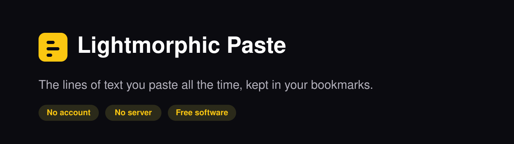
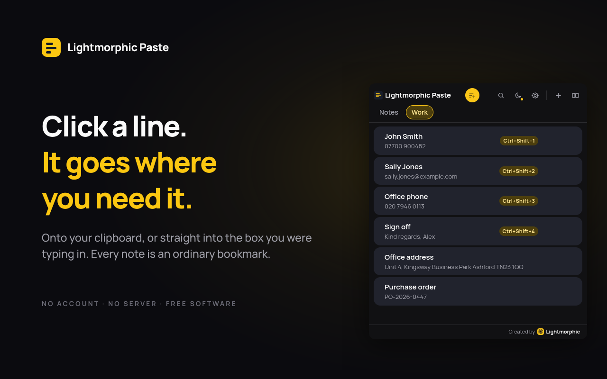
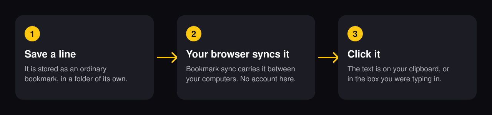

  

  
  
  
  

**Lightmorphic Paste is a small browser extension for the short pieces of text you type over and over:** your email address, a postal address, a sign-off, a licence header, a reference number. Click the toolbar icon, click the line you want, and it is on your clipboard.

Every note is an ordinary bookmark, so your notes travel between your computers on your browser's own bookmark sync. There is no account to make, no server to trust and nothing to pay for. It makes no network requests of any kind: no analytics, no advertising, no crash reporting.

  

[Website](https://paste.lightmorphic.com/) · [Help](https://paste.lightmorphic.com/help) · [Questions](https://paste.lightmorphic.com/faq)

## How it works

  

Notes live in the browser's bookmarks like this:

    Other bookmarks/
      Lightmorphic Paste/
        Personal/            <- a tab
          Email address      <- a note; the text lives in the bookmark's URL
          Home address
        Work/

You can rename that folder or drag it wherever you like. It is found by what is inside it, not by its name, so nothing breaks.

> **One thing worth knowing.** Because notes are bookmarks, they are as visible as any other bookmark. Anyone who can open your browser can read them. Lightmorphic Paste says so the first time you open it. Keep passwords and card numbers out of it and use a password manager for those.

## Quick start

Install it from the [Chrome Web Store](https://chromewebstore.google.com/detail/lightmorphic-paste/heefkhhoccopkeecmaainfdgppeljkfb). It works in Chrome, Brave, Vivaldi and Edge, and updates arrive on their own.

Then:

1. Click the Paste icon in the toolbar, and press the round yellow button to add a note
2. Click a note to copy it, or turn on copy-and-paste in settings so a click also drops the text into the box you were typing in
3. Use Ctrl+Shift+1 to Ctrl+Shift+4 to paste the first four notes straight into whatever you are typing in

Nothing needs setting up first. Your notes are untouched when the extension updates; they live in bookmarks, not in the extension.

## What it does

- Up to six tabs to group notes, named with up to seven letters. Those numbers
  go together: seven letters makes a tab at most 100px wide, three of those fit
  across the strip, and the strip is two rows tall. So every tab is always
  visible with nothing to scroll and nothing pushed out of reach
- The icon and the name sit at the top left, and the round accent-coloured
  button that adds a note sits centred between the name and the search icon
- Every button sits on the top row: the round accent-coloured one adds a note,
  then search, light or dark and settings, then a divider and the two tab
  controls. There is no footer, so the list gets the rest of the window, and
  messages appear briefly over the bottom of it
- Tabs are dragged into the order you want, and notes by the grip on the left.
  A thin line shows the gap it will drop into.
  Both are built on pointer events rather than HTML5 drag and drop, because a
  native drag closes an extension popup before the drop can land. Renaming and
  deleting a tab happens in a small popover under the button, not a whole screen
- A tab is only created once it has a name, so there are never several called
  "New tab". Two tabs cannot share a name either
- Click a note to copy it, or turn on copy-and-paste in settings so a click also
  drops the text into the box you were typing in. Hovering a note says which of
  the two it will do, because pasting puts text somewhere it might not belong.
  The paste button on each note pastes either way
- Four keyboard slots, Ctrl+Shift+1 to Ctrl+Shift+4, pasting straight into
  whatever you are typing in. Four because that is every shortcut a browser lets
  an extension arrive with; more slots than keys would only be slots nothing can
  reach. Alt and a number is deliberately not used: browsers keep that for
  jumping to a pinned tab and always win
- Right-click selected text on a page to save it
- Right-click inside a text box to paste any note from the current tab
- Search across every tab
- Follows the browser's light or dark setting on its own. A button in the list
  overrides it either way; a dot on that button means the browser is choosing
- Twelve accent colours, plus a box for a colour of your own: the lighter and
  darker shades it needs are worked out from whatever you type
- One-click import of notes left behind by an older snippet extension, found
  by the shape of the bookmarks rather than by any folder name (it copies;
  nothing is removed)
- Backup to a JSON file, and restore from one

## Settings

Everything is on the extension's settings page. Nothing is needed to start.

| Setting | Required | Default | What it does |
|---|---|---|---|
| Light or dark | No | Follows the browser | A button in the list overrides it either way |
| Accent colour | No | Yellow | Twelve colours, or a box for your own |
| Clicking a note | No | Copy | Copy only, or copy and paste into the box you were typing in |
| Keyboard shortcuts | No | Ctrl+Shift+1 to 4 | Four slots, changed in the browser's own shortcuts page |
| Bring notes over | No | Off | Copies notes left by an older snippet extension; nothing is removed |
| Backup | No | None | Saves a JSON file, and restores from one (restoring adds, never replaces) |

## Where your data lives

Only in your browser's bookmarks, in a folder of their own. There is no server and no copy anywhere else. Bookmark sync keeps notes together within one browser's own sync, so Firefox notes and Vivaldi notes are separate; use the backup file to move between them.

## Security

The extension makes no network requests, declares no host permissions, and its content security policy is `script-src 'self'`. It asks for six permissions: `bookmarks`, `storage`, `contextMenus`, `scripting`, `activeTab` and `clipboardWrite`. See [SECURITY.md](SECURITY.md) for what is worth reporting and how to report it privately.

## Building it yourself

There is no build step for Chrome. The `chrome` folder is the source of truth and runs exactly as written, so what is in this repository is what runs in your browser. See Layout below, and [CONTRIBUTING.md](CONTRIBUTING.md) for how to send feedback.

## Licence

Copyright Lightmorphic Ltd. Released under the GNU General Public License, version 3 or (at your option) any later version. The full text is in [LICENSE](LICENSE), and every version since 1.0.0 is under it. What changed and when is in [CHANGELOG.md](CHANGELOG.md). The interface is set in Manrope by Mikhail Sharanda, under the SIL Open Font License; see [CREDITS.md](CREDITS.md).

## Disclaimer

The software is provided as it is, with no warranty of any kind. Lightmorphic Ltd is registered in England and Wales, company number 17423646, registered office 82A James Carter Road, Mildenhall, IP28 7DE.

## Layout

    chrome/            load this one in Vivaldi, Brave or Edge: this is what ships
      manifest.json
      background.js    keyboard slots, right-click menus, paste
      content.js       injected on demand to put text in the focused field
      popup.html/.js   the list
      options.html/.js settings, import, backup
      lib/store.js     everything that touches bookmarks
      style.css        one stylesheet, no framework
      fonts/           Manrope and its OFL licence, self-hosted
      icons/           the extension's own, plus the Lightmorphic mark
    firefox/           built from chrome/ by build-firefox.sh
    docs/              the website, served by Cloudflare Pages
    dev/               preview.sh / clean.sh, and the fake-browser stub
    dist/              the zips package.sh builds; not in git
    store/             the listing artwork, the audit, and the submission notes
    build-firefox.sh   run after changing anything in chrome/
    package.sh         builds the store zips; refuses if a dev file or the font
                       licence is missing, and copies LICENSE into the package
    PRIVACY.md         the privacy statement, served at /privacy on the site
    CHROMEWEBSTORE.md  listing text, single purpose, and permission wording
    CREDITS.md         third-party licences: Manrope under the SIL OFL

## Previewing without a browser install

    ./dev/preview.sh     writes chrome/dev-popup.html and chrome/dev-options.html
    ./dev/clean.sh       removes them again

Those pages stub out the browser APIs so the interface can be opened in a plain
tab. `package.sh` refuses to build if they are still lying about.

## Packing for the stores

    ./dev/clean.sh
    ./package.sh

Writes `dist/lightmorphic-paste-chrome-<version>.zip` and the Firefox one beside it.

## The first-run notice

The first time the list is opened it explains, once, that notes are bookmarks:
they follow you between computers with no account, and they are as readable as
any other bookmark, so passwords and card numbers do not belong in them. It has
to be acknowledged rather than dismissed, and the same warning stays on the
settings page afterwards.

## Deleting

Nothing is deleted on one click. Every delete is a bin icon; clicking it turns
the bin into a tick and the wording beside it goes red. Only the tick deletes,
and it gives up after four seconds if left alone. This is the same for a note in
the list, a note in the editor, and a whole tab.

The last remaining tab cannot be deleted, because the notes would have nowhere
to live.

## Notes

- Edit `chrome/` only, then run `./build-firefox.sh`. The two folders are
  identical apart from the manifest.
- A note's text sits in the bookmark's URL as
  `https://lightmorphic.invalid/#pm1:...`. `.invalid` is a reserved name that
  can never resolve, so a stray click goes nowhere. Notes saved by the very
  first build used a `javascript:` URL instead; those are still read, and are
  quietly rewritten the next time you edit them.
- Restoring a backup **adds** notes; it does not replace what is there.
- Running the import twice is safe: anything already there is skipped.
- Bookmark sync keeps notes together within one browser's own sync. Firefox
  notes and Vivaldi notes are separate; use the backup file to move between
  them.
